# Окружение и запуск

ClickHouse 25.8.33.6, Docker Compose. Источник — *listening_events.csv.gz* из LMS, 10 000 000 событий за 13–26 октября 2026 года (UTC). Версия, количество и период проверены запросами из [подготовки](result/00_prepare_source.sql)

1. Положить *listening_events.csv.gz* в *data/*, не распаковывая
2. Запустить *docker compose up -d --wait*
3. Открыть http://localhost:8123/play (*student* / *takt*). Команды SQL выполнять по одной
4. При первой загрузке выполнить [00_prepare_source.sql](result/00_prepare_source.sql). При последующих запусках загрузку пропустить
5. Выполнить по порядку [01_report.sql](result/01_report.sql), [02_order_by.sql](result/02_order_by.sql), [03_codecs.sql](result/03_codecs.sql), [04_mv.sql](result/04_mv.sql), включая блоки подготовки соответствующих заданий
6. После работы — *docker compose stop*

Исходный gzip и Docker-том в репозиторий не включаются

# 1. Аналитический отчёт

## 1.1. Отчёт по странам

[SQL отчёта и контрольного запроса](result/01_report.sql)

Период: 20–26 октября 2026 года, UTC (*ended_at >= 2026-10-20* и *< 2026-10-27*).
Учитываются все платформы и версии приложения. Каждая запись считается отдельным событием

Запрос отбирает события за указанный период и группирует их по стране. *count()* считает все события страны, *countIf(played_seconds < 20)* — события короче 20 секунд. Их доля рассчитывается как *100 × число коротких событий / число всех событий* и округляется до двух знаков. Результат отсортирован по стране

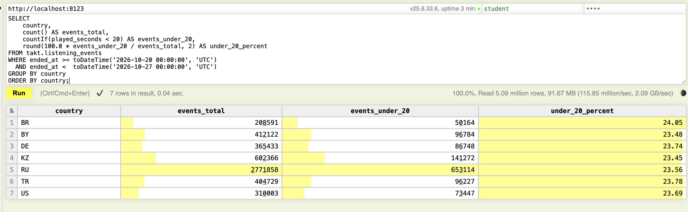

## 1.2. Проверка на семи событиях

### Ручной расчёт

Два события RU за границами периода исключаются. Значение ровно 20 секунд не считается коротким прослушиванием

| Страна | Длительности в периоде, с | Всего событий | Событий < 20 с | Расчёт доли |
|:---|:---|---:|---:|:---|
| KZ | 5, 20 | 2 | 1 | 100 × 1 / 2 = 50.00% |
| RU | 19, 20, 21 | 3 | 1 | 100 × 1 / 3 ≈ 33.33% |

### Результат запроса

Контрольный запрос — «Проверка отчета» в [SQL-файле](result/01_report.sql)

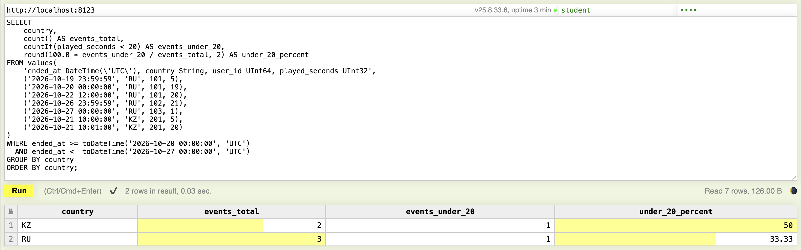

**Проверка:** обе строки и все показатели совпали с ручным расчётом. Проценты сравнены после округления до двух знаков

## 1.3. Объяснение результатов

### Что означает процент в отчёте

Для DE из 365 433 событий 86 748 длились меньше 20 секунд:

*100 × 86 748 / 365 433 ≈ 23.74%*

То есть 23.74% событий прослушивания в Германии за выбранный период были короче 20 секунд

### Доля событий и доля слушателей

В контрольном примере KZ оба события принадлежат одному слушателю — *user_id = 201*

| Показатель | Расчёт | Результат |
|:---|:---|---:|
| Доля событий короче 20 секунд | 1 короткое событие / 2 события | 50% |
| Доля слушателей с хотя бы одним коротким событием | 1 слушатель / 1 слушатель | 100% |

Один слушатель может создать несколько событий, поэтому эти доли могут различаться

# 2. Ключ сортировки

## 2.1. Подготовка таблиц

[SQL подготовки и проверки](result/02_order_by.sql)

Две копии исходных данных отличаются ключом сортировки: *ended_at* и *(country, ended_at)*. Схема, типы, кодеки и настройки гранулярности одинаковы. После *OPTIMIZE … FINAL* в каждой таблице одна активная часть и 10 000 000 событий

### Проверка частей и количества событий

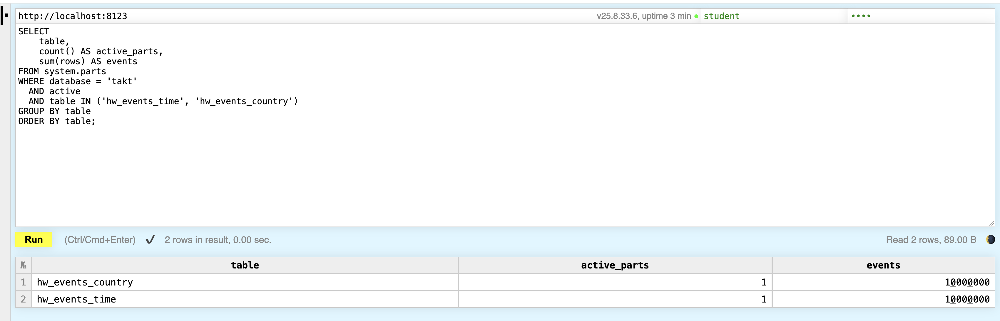

### Ключ по времени

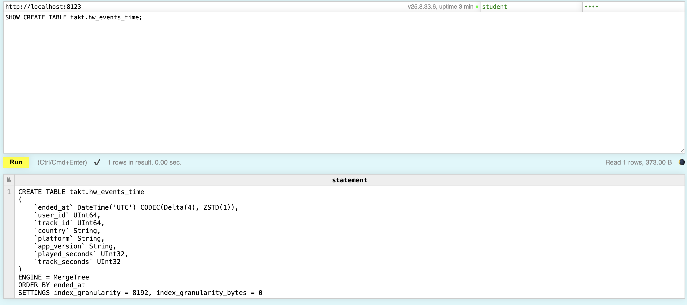

### Ключ по стране и времени

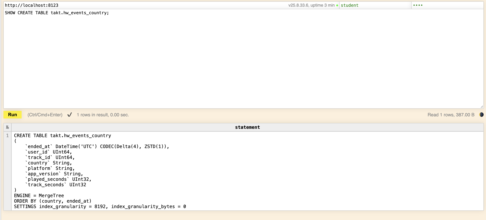

## 2.2. Сравнение запросов

Прогноз: ключ *(country, ended_at)* уменьшит чтение для Германии, поскольку позволяет отбирать данные по стране и времени. Для всех стран предположительно выгоднее *ended_at*: события нужного дня расположены подряд, а при ключе *(country, ended_at)* — в отдельных диапазонах каждой страны

### Результаты и чтение

[SQL четырёх запросов](result/02_order_by.sql). Период — 24 октября 2026 года, UTC. Read из */play* после обычных SELECT, значения округлены

| Запрос | Ключ | Granules | Прочитано строк, тыс. | Прочитано, MB | SQL, результат и план |
|:---|:---|:---|---:|---:|:---|
| Германия | *ended_at* | 102/1221 | 835.58 | 15.04 | [Германия — ключ по времени](#германия--ключ-по-времени) |
| Германия | *(country, ended_at)* | 8/1221 | 65.54 | 1.18 | [Германия — ключ по стране и времени](#германия--ключ-по-стране-и-времени) |
| Все страны | *ended_at* | 102/1221 | 835.58 | 15.04 | [Все страны — ключ по времени](#все-страны--ключ-по-времени) |
| Все страны | *(country, ended_at)* | 114/1221 | 931.46 | 16.77 | [Все страны — ключ по стране и времени](#все-страны--ключ-по-стране-и-времени) |

Ответы по Германии совпали между таблицами: 59 423 события, 14 833 короче 20 секунд, доля 24.96%. Отчёты по всем странам совпали по всем семи строкам и четырём показателям. Строка DE в обоих общих отчётах совпадает с отдельными отчётами по Германии

### Германия — ключ по времени

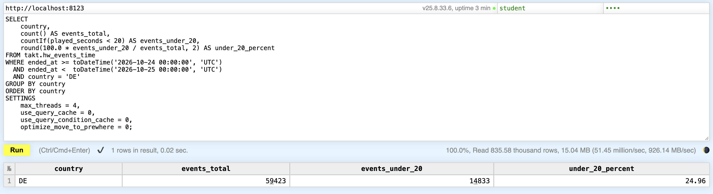

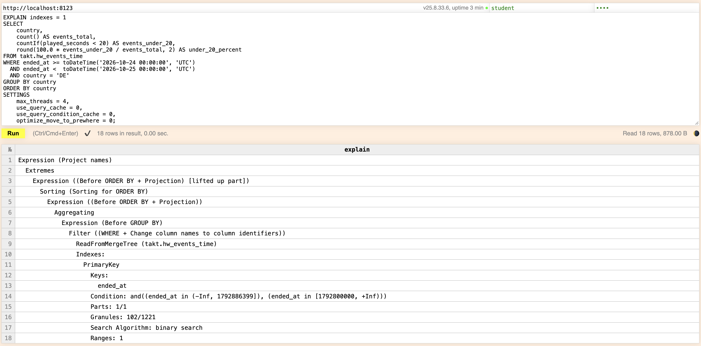

### Германия — ключ по стране и времени

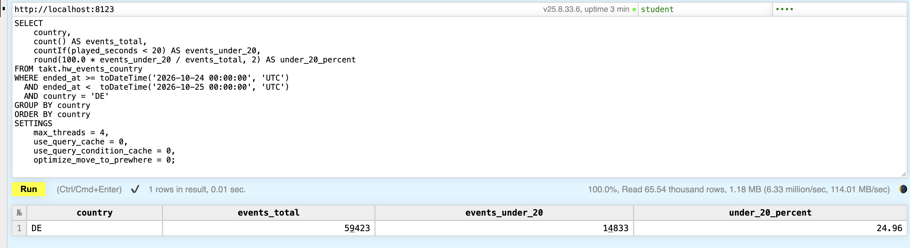

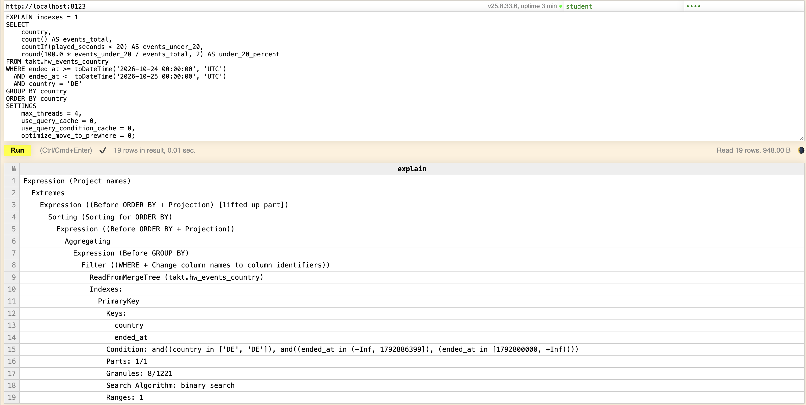

### Все страны — ключ по времени

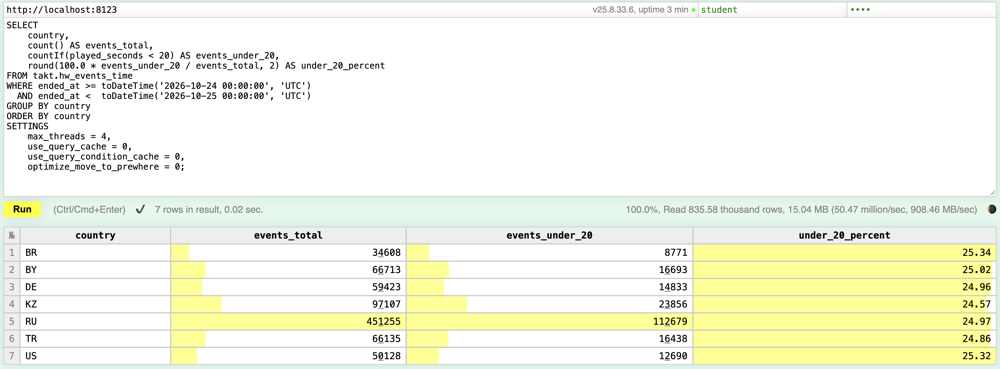

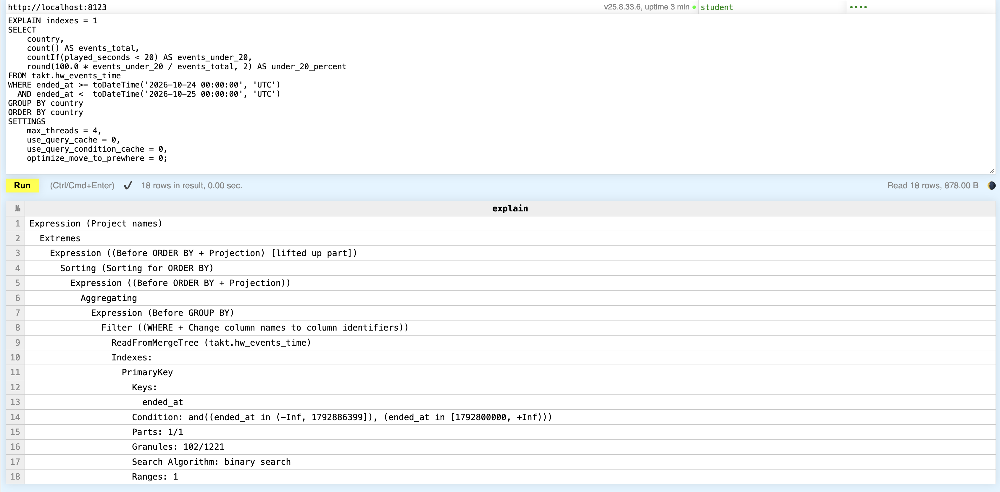

### Все страны — ключ по стране и времени

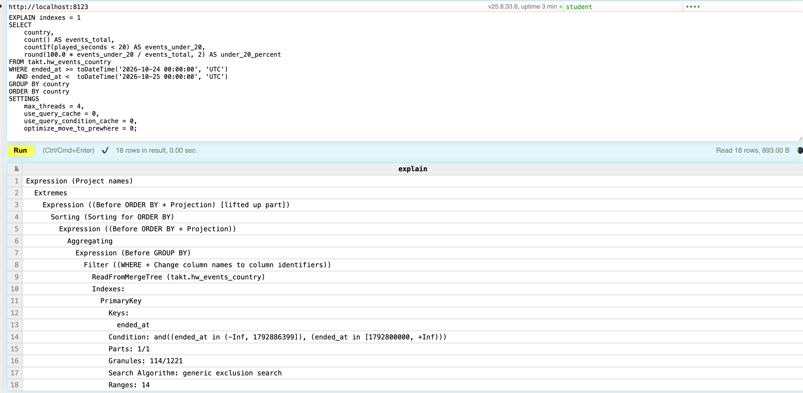

## 2.3. Выводы

### Сравнение чтения

Для Германии ключ *(country, ended_at)* сократил отбор со 102 до 8 гранул из 1221. Чтение уменьшилось с 835.58 до 65.54 тыс. строк, с 15.04 до 1.18 MB — примерно в 12.75 раза

Для всех стран ключ *ended_at* оказался выгоднее: 102 гранулы против 114, 835.58 против 931.46 тыс. прочитанных строк и 15.04 против 16.77 MB

### Как ключ влияет на отбор гранул

При ключе *ended_at* события расположены по времени независимо от страны. В обоих планах индекс использует только *ended_at* и выбирает один диапазон из 102 гранул. Фильтр *country = 'DE'* применяется к прочитанным данным и не сокращает отбор гранул

При ключе *(country, ended_at)* события сначала разделены по стране, внутри каждой страны — по времени. Для Германии план использует оба поля и выбирает один диапазон из 8 гранул. Без фильтра страны индекс всё ещё использует время, но нужный день находится в отдельных участках: план показывает 14 диапазонов и 114 гранул. На границах этих диапазонов приходится читать лишние строки

### Подходящие события, прочитанные строки и строки отчёта

На *hw_events_time* отчёту по Германии соответствуют 59 423 события, общему отчёту — 825 369 событий (сумма *events_total*). При этом оба запроса читают по 835.58 тыс. строк: индекс отбирает одинаковые гранулы по времени, включая строки за границами суток. Условие страны отбрасывает события уже после чтения

После группировки Германия даёт 1 строку результата, все страны — 7 строк. Эти количества описывают разные этапы: чтение гранул, фильтрацию событий и построение итоговых групп. Меньше подходящих событий поэтому не обязательно означает меньше чтения

### Выбор ключа

Для запроса по Германии выбираю *(country, ended_at)*, для запроса по всем странам — *ended_at*: в каждом случае этот ключ дал меньший объём чтения

Для выбора одного ключа на весь сервис нужны состав и частота остальных запросов, их фильтры и периоды, требования к задержкам, объём и распределение данных, нагрузка вставок, затраты на слияния и сжатие. Два исследованных запроса не определяют всю нагрузку сервиса

# 3. Кодеки

## 3.1. Подготовка модели

[SQL подготовки и проверок](result/03_codecs.sql)

Созданы два набора из 500 000 временных меток с шагом в секунду. В *hw_codec_ordered* ключ — *event_no*, в *hw_codec_mixed* — *(cityHash64(event_no), event_no)*. Три временные колонки содержат одинаковые значения и используют *ZSTD(1)*, *Delta, ZSTD(1)* и *DoubleDelta, ZSTD(1)*

### Проверка данных

В каждой таблице 500 000 строк и уникальных идентификаторов от 0 до 499 999; *bad_rows = 0*. Наборы полные, временные значения соответствуют модели и совпадают во всех трёх колонках

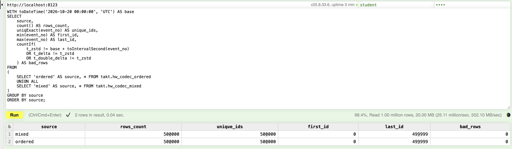

### Проверка частей

В каждой таблице одна активная часть *Wide* и 500 000 строк. Формат *Wide* позволяет измерять размеры отдельных колонок

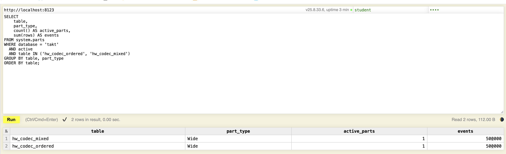

## 3.2. Соседние значения и разности

[SQL выборки](result/03_codecs.sql). Расчёты выполнены по *seconds_from_start*: секундам относительно 20 октября 2026 года, 00:00:00 UTC. Первая разность — следующее значение минус предыдущее; вторая — следующая первая разность минус предыдущая

### Регулярный порядок

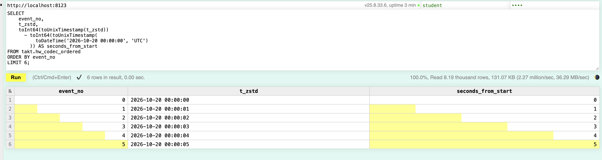

| Ряд | Значения, с |
|:---|:---|
| Исходные значения | 0, 1, 2, 3, 4, 5 |
| Первые разности | 1, 1, 1, 1, 1 |
| Вторые разности | 0, 0, 0, 0 |

Шаг постоянный — одна секунда. Первые разности одинаковы, вторые равны нулю

### Перемешанный порядок

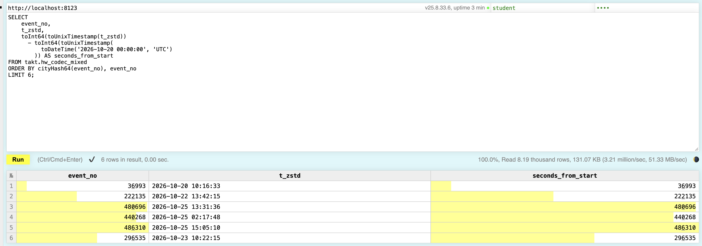

| Ряд | Значения, с |
|:---|:---|
| Исходные значения | 36993, 222135, 480696, 440268, 486310, 296535 |
| Первые разности | 185142, 258561, -40428, 46042, -189775 |
| Вторые разности | 73419, -298989, 86470, -235817 |

Постоянного шага нет: разности меняются по величине и знаку. Регулярность исходного набора нарушена порядком хранения

### Восстановление значений

Для перемешанного фрагмента кроме вторых разностей нужны первое значение *x₀ = 36993* и первая разность *d₁ = 185142*. Для восстановления абсолютного времени также сохраняется общее начало отсчёта

- Первое значение: *x₀ = 36993*
- Второе: *x₁ = x₀ + d₁ = 36993 + 185142 = 222135*
- Следующая первая разность: *d₂ = d₁ + 73419 = 258561*
- Третье: *x₂ = x₁ + d₂ = 222135 + 258561 = 480696*

Остальные значения восстанавливаются так же: прибавляем вторую разность к предыдущей первой, затем полученную первую разность — к предыдущему значению

## 3.3. Размеры колонок

Прогноз: в регулярном порядке разностные кодеки дадут хорошо сжимающиеся последовательности единиц и нулей. Перестановка нарушит эту закономерность, поэтому ожидаю увеличения сжатого размера, особенно у цепочек с *Delta* и *DoubleDelta*. Минимальный размер определим по измерению

[SQL измерения](result/03_codecs.sql). Размеры данных колонок активных частей указаны в байтах. *compression_ratio* — отношение несжатого размера к сжатому

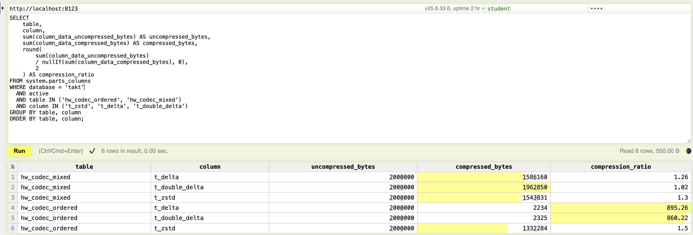

## 3.4. Выводы

### Сравнение цепочек

В таблице с последовательными временными метками минимальный размер у *Delta + ZSTD* — 2 234 байта. *DoubleDelta + ZSTD* занимает 2 325 байт, а *ZSTD* без разностного преобразования — 1 332 284 байта

В перемешанной таблице минимальный размер у *ZSTD* — 1 543 831 байт. *Delta + ZSTD* занимает 1 586 160 байт, *DoubleDelta + ZSTD* — 1 962 850 байт. Здесь оба разностных преобразования увеличили итоговый размер по сравнению с одним *ZSTD*

### Влияние порядка

Для *Delta + ZSTD* перестановка увеличила размер с 2 234 до 1 586 160 байт — примерно в 710 раз. В регулярном порядке соседние времена отличаются на одну секунду: повторяющиеся единицы хорошо сжимаются. В перемешанном фрагменте разности большие, разного знака и без постоянного шага, поэтому такого выигрыша нет

### Delta, DoubleDelta и ZSTD

*Delta* кодирует разности соседних значений. *DoubleDelta* — разности между соседними первыми разностями. При постоянном шаге в секунду получаются соответственно единицы и нули. Начальные значения позволяют восстановить исходный ряд

*ZSTD* затем сжимает полученное представление без потерь. Итоговый размер зависит от повторяемости данных и служебных расходов кодирования. Дополнительное преобразование не гарантирует меньшего размера: в нашем регулярном наборе *DoubleDelta + ZSTD* немного больше *Delta + ZSTD*, а в перемешанном обе цепочки проиграли одному *ZSTD*

### Выбор порядка хранения

Порядок влияет и на сжатие, и на чтение. В задании 2 ключ *(country, ended_at)* уменьшил чтение для Германии, а *ended_at* оказался выгоднее для всех стран. Поэтому при выборе ключа нужно учитывать реальные запросы и их частоту вместе с размером данных. В этом опыте измерялся только размер колонок; скорость записи и запросов не сравнивалась

### Сохранение информации

Эти кодеки сжимают данные без потерь: исходное время каждого события восстанавливается точно. Поэтому можно точно посчитать события за новый интервал, например с 10:15 включительно до 10:45 исключительно выбранного дня

Если сохранить только дневные количества, время отдельных событий будет потеряно. Два набора с одинаковым дневным итогом могут иметь разное число событий внутри этих 30 минут. По одним дневным количествам точный ответ получить нельзя

# 4. Материализованное представление

## 4.1. Источник и создание MV

[SQL подготовки и MV](result/04_mv.sql)

Источник *hw_mv_events* содержит 10 000 000 событий, загруженных до создания MV

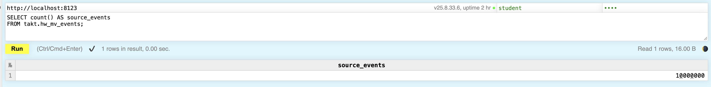

MV группирует новые события по *toStartOfHour(ended_at)* и стране, записывая количество событий, количество событий короче 20 секунд и сумму секунд в *hw_country_hourly*. Ограничения периода и *POPULATE* не используются

После создания MV таблица итогов пуста: *stored_rows = 0*. Ранее загруженная история автоматически не обработалась

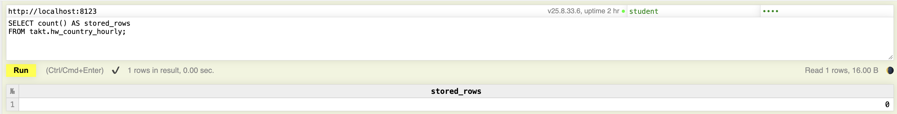

## 4.2. Общий контроль

[SQL заполнения истории и общего контроля](result/04_mv.sql)

История однократно записана непосредственно в *hw_country_hourly*. Контроль сравнивает количество событий, количество коротких событий и сумму секунд с исходными данными по каждому часу и стране

### После заполнения истории

Расхождений нет — запрос вернул 0 строк

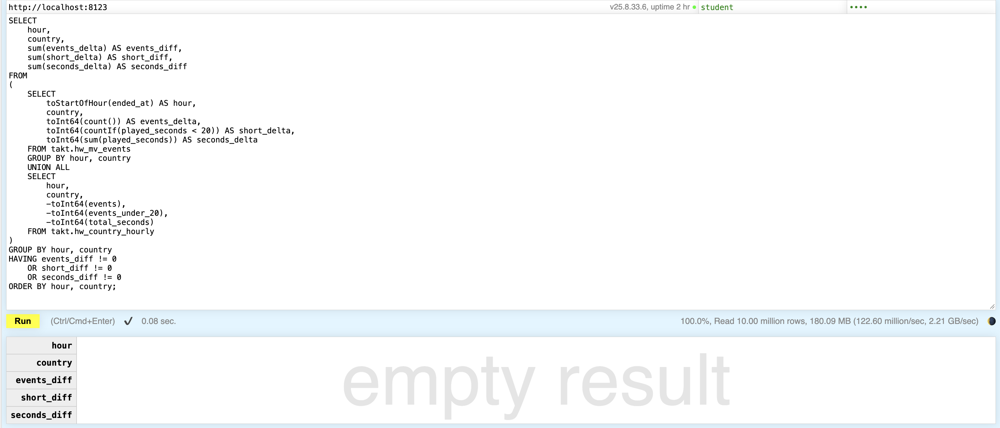

### После порции А

Тот же общий контроль вернул 0 строк расхождений

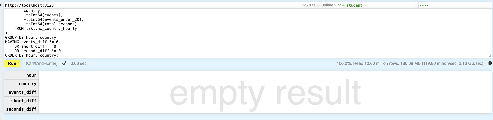

### После порции Б

Общий контроль вернул 0 строк расхождений

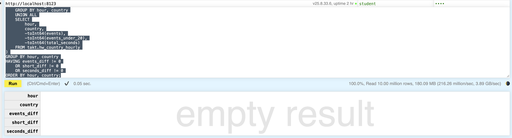

## 4.3. Проверка новых событий

[SQL вставок и отчёта](result/04_mv.sql)

Отчёт читает *hw_country_hourly*: объединяет показатели через *sum* и *GROUP BY hour, country*, затем вычисляет процент и среднюю длительность. Период — 27 октября, с 19:00 включительно до 21:00 исключительно, UTC

### Порция А — ручной расчёт

Для RU вставляются длительности 5, 19, 20 и 40 секунд: 4 события, 2 коротких, сумма 84 секунды. Доля — *100 × 2 / 4 = 50%*, средняя — *84 / 4 = 21 с*. Для KZ одно событие на 25 секунд, коротких нет

| Час, UTC | Страна | Событий | Коротких | Сумма, с | Доля, % | Средняя, с |
|:---|:---|---:|---:|---:|---:|---:|
| 2026-10-27 19:00:00 | KZ | 1 | 0 | 25 | 0.00 | 25.00 |
| 2026-10-27 19:00:00 | RU | 4 | 2 | 84 | 50.00 | 21.00 |

### Порция А — результат запроса

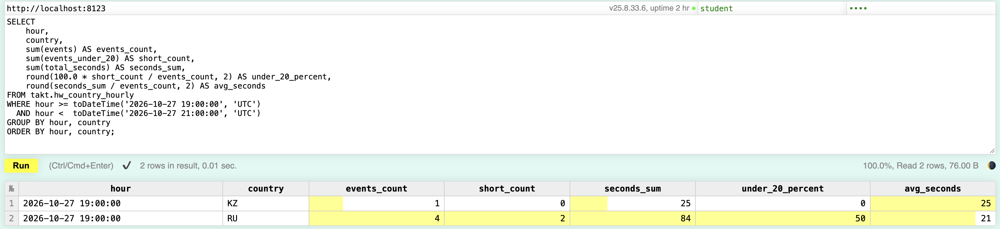

Обе строки и все показатели совпали с ручным расчётом

### Порция Б — ручной расчёт

К RU за 19:00 добавляется 1 секунда: теперь 5 событий, 3 коротких, сумма 85 секунд, доля *100 × 3 / 5 = 60%*, средняя *85 / 5 = 17 с*. За 20:00 появляется одно событие RU на 10 секунд. KZ не меняется. Событие на 7 секунд относится к старому часу 24 октября и в этот отчёт не входит

| Час, UTC | Страна | Событий | Коротких | Сумма, с | Доля, % | Средняя, с |
|:---|:---|---:|---:|---:|---:|---:|
| 2026-10-27 19:00:00 | KZ | 1 | 0 | 25 | 0.00 | 25.00 |
| 2026-10-27 19:00:00 | RU | 5 | 3 | 85 | 60.00 | 17.00 |
| 2026-10-27 20:00:00 | RU | 1 | 1 | 10 | 100.00 | 10.00 |

### Порция Б — результат запроса

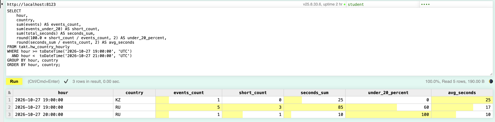

Все три строки и все показатели совпали с ручным расчётом; проценты и средние сравнены после округления до двух знаков

## 4.4. Опоздавшее событие и количество источника

### Историческая группа до Б

RU, 24 октября 2026 года, 12:00 UTC: 26 478 событий, 6 655 коротких, сумма 3 659 184 секунды, доля 25.13%, средняя длительность 138.20 секунды

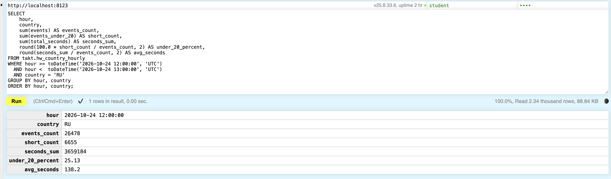

### Историческая группа после Б

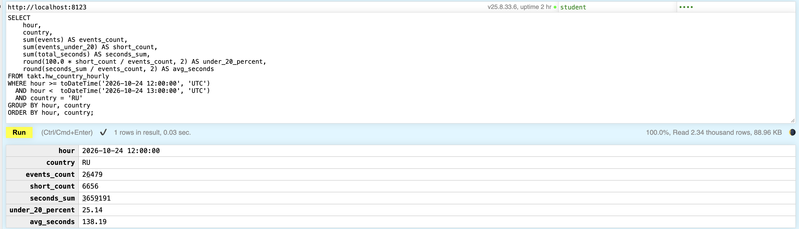

| Показатель | До Б | После Б | Изменение |
|:---|---:|---:|---:|
| Событий | 26 478 | 26 479 | +1 |
| Событий короче 20 секунд | 6 655 | 6 656 | +1 |
| Сумма секунд | 3 659 184 | 3 659 191 | +7 |

Опоздавшее событие обработано MV и добавлено к часу своего завершения — 24 октября, 12:00 UTC. Доля стала 25.14%, средняя длительность — 138.19 секунды

### Итоговое количество событий

Источник содержит *N + 8 = 10 000 008* событий: исходная история, 5 событий порции А и 3 события порции Б

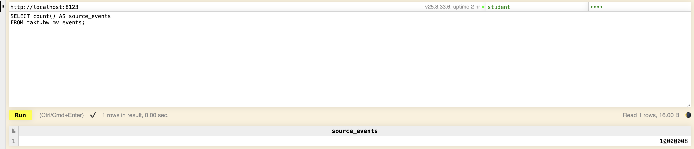

## 4.5. Объяснение работы MV

### Новые блоки и опоздавшее событие

При вставке Б MV обработало только три новых события, а не всю таблицу источника. Час определяется по *ended_at*, поэтому событие *2026-10-24 12:34:00, RU, 7 с* увеличило итоги за 24 октября, 12:00 UTC на *+1 / +1 / +7*

История была загружена до создания MV и автоматически в итоги не попала, поэтому её пришлось отдельно записать в target. После этого новые события добавлялись только в источник и обрабатывались через MV

### Зачем sum и GROUP BY при чтении

Разные вставки могут создать несколько строк итогов для одной пары «час, страна». *SummingMergeTree* объединяет их при фоновых слияниях, но к моменту запроса слияние может ещё не произойти. Поэтому отчёт сам суммирует показатели по *hour, country* и получает правильный ответ независимо от состояния частей

### Почему нельзя усреднять проценты и средние порций

Для RU, 27 октября, 19:00 в порции А было 4 события, 2 коротких и 84 секунды. Из порции Б в эту группу входит только одно событие на 1 секунду

| Расчёт | Доля коротких событий | Средняя длительность |
|:---|:---|:---|
| Порция А | 100 × 2 / 4 = 50% | 84 / 4 = 21 с |
| Вклад порции Б | 100 × 1 / 1 = 100% | 1 / 1 = 1 с |
| Правильный итог | 100 × (2 + 1) / (4 + 1) = 60% | (84 + 1) / (4 + 1) = 17 с |
| Обычное среднее двух порций | (50 + 100) / 2 = 75% | (21 + 1) / 2 = 11 с |

Обычное среднее даёт порциям одинаковый вес, хотя в них 4 и 1 событие. Правильный отчёт делит суммарное количество коротких событий и суммарную длительность на общее количество событий

### Можно ли сменить порог на 10 секунд

По одному target гарантированно пересчитать долю событий с *played_seconds < 10* нельзя. В нём сохранены общее количество, количество событий короче 20 секунд и сумма секунд, но нет распределения длительностей внутри группы

Например, длительности *5 и 15* и длительности *10 и 10* дают одинаковые итоги: 2 события, оба короче 20 секунд, сумма 20 секунд. Однако в первом наборе одно событие короче 10 секунд, во втором — ни одного. Для нового порога нужны исходные события или дополнительно сохранённые показатели, позволяющие посчитать этот порог
